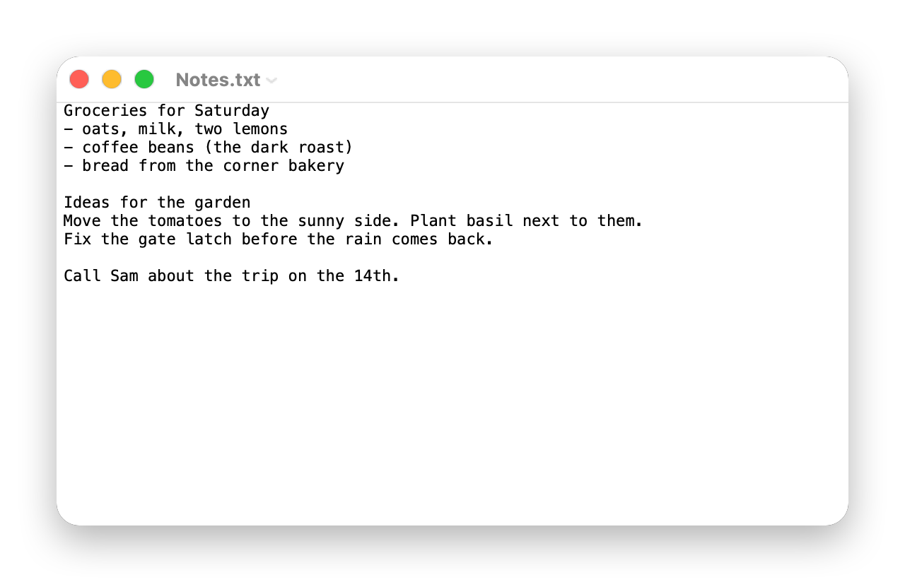

# QuickEdit

QuickEdit is a plain-text editor for macOS 27, written in Swift with AppKit. It opens, edits and saves plain text, and it starts quickly.

<picture>
  <source media="(prefers-color-scheme: dark)" srcset="docs/images/window-dark.png">
  
</picture>

QuickEdit needs a Mac with Apple silicon and macOS 27 or later. Its web page is [yili.dev/projects/quickedit](https://yili.dev/projects/quickedit/).

## Install

1. Download the DMG from the [latest release](https://github.com/wizdes/QuickEdit/releases/latest) and open it.
2. Drag QuickEdit to the Applications folder.
3. Open QuickEdit from Launchpad or the Applications folder.

The app and the DMG are signed with a Developer ID and notarized by Apple, so macOS opens them without a warning.

## What it does

- Opens and saves plain-text files (`.txt`, Markdown, JSON, source code and any other file macOS calls text). New files are saved as UTF-8.
- Reads and writes many text encodings, and lets you pick one in the Open and Save panels.
- Find and Replace, Select Line (Cmd+L), spelling and grammar checks, and the Substitutions menu.
- Wrap to Window and Wrap to Page, zoom, and a Settings window for new documents and for opening and saving.
- Print (Cmd+P) and Export as PDF both save a PDF. QuickEdit never talks to a printer.
- Opens very large files. A file over 512 MiB opens read-only: you can view it, search it and copy from it.
- Works with the Services menu, the Share menu, Writing Tools and Quick Look.

## What it does not do

- No rich text: no fonts per word, no colors, no images, no tables. QuickEdit never writes RTF or Word files.
- No AppleScript support, and no Services of its own (the Services menu that macOS adds still works).
- No real printing; see the note on Print above.

## Tabs

A window can hold several documents as tabs.

- File > New Tab (Cmd+T) opens a new untitled document in a tab of the front window. The + button in the tab bar does the same.
- File > Close Tab (Cmd+W) closes only the tab you are in. When one tab is left, the item is called Close again, and the last Cmd+W closes the window.
- Window > Show Next Tab (Ctrl+Tab) and Show Previous Tab (Ctrl+Shift+Tab) move between tabs. They wrap around at the ends.
- The tab bar shows when a window has two or more tabs, and hides again at one.
- Window > Merge All Windows puts every window into one as tabs. Window > Move Tab to New Window takes a tab back out.

New (Cmd+N) and opening a file follow the "Prefer tabs" setting in System Settings > Desktop & Dock. The three tab keys can be changed in Settings > Keyboard, like any other command. If you already gave Cmd+T, Ctrl+Tab or Ctrl+Shift+Tab to another command, that command keeps it and the tab command starts with no key.

## Keyboard shortcuts

Every menu command can have its own shortcut. Open QuickEdit > Settings > Keyboard:

1. Click a command's shortcut and press the new keys.
2. If another command or the system already uses those keys, a message under the table says so, and VoiceOver reads it.
3. Use the reset button on a row to put back one shortcut, or Restore Keyboard Defaults to put back all of them.

Recording and reset also work from the keyboard alone.

## Sandbox

QuickEdit runs in the App Sandbox. It can read and write only the files you open or save through its panels, Finder, the Dock or Open Recent. It cannot reach other files on your Mac or the network.

## Known limit when updating from an early build

QuickEdit 1.0 and later keep their data in the app's own sandbox folder. Your settings move there at the first launch. Untitled documents autosaved by a build from before 1.0, and that build's window positions, do not come back. Save any Untitled document you want to keep before you update.

## Build and test

You need Xcode 27 and XcodeGen (`brew install xcodegen`).

```sh
./build.sh            # Release build to build/Release/QuickEdit.app
./build.sh quick      # lint, unit tests and the main UI tests (under 10 minutes)
./build.sh test       # every shell, unit and UI test (about 25 minutes)
```

UI tests take over the keyboard and mouse. Run them with the screen unlocked, and do not type while they run.

## License and credits

© 2026 Yi Li. The `reference` folder holds Apple sample code under Apple's sample code license, kept for comparison; it is not part of the app.
